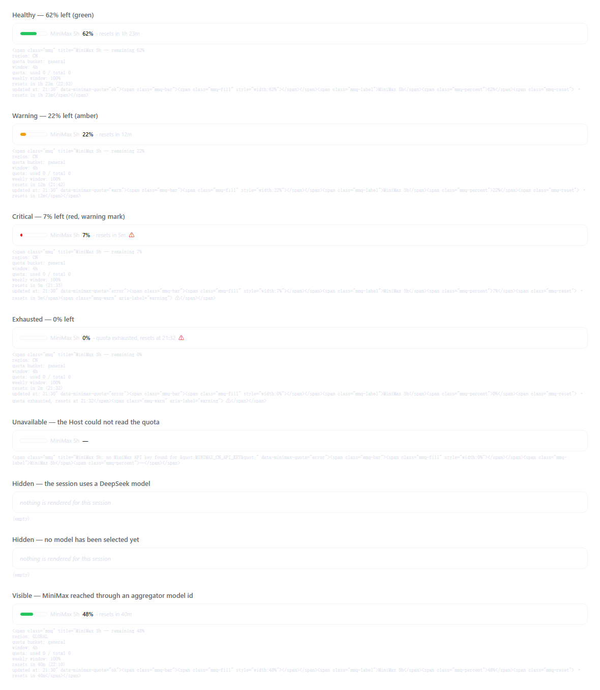

# MiniMax quota status line for DeepSeek Harness

A dual-half DSH plugin that shows how much of the MiniMax token-plan window is
left, directly under the message composer. The reading appears only while the
session actually routes to a MiniMax model; any other model leaves the dock
empty.



## Layout

| Path | Contents |
|---|---|
| `dsh-minimax-quota/` | the installable plugin (Host half, browser half, locale, bundle patch) |
| `docs/` | rendered status states, live captures and the theme variables the preview uses |
| `tools/` | the offline client renderer and the live Host smoke test |

The plugin's own documentation — configuration, credential resolution, the
upstream API fields and the slot contract — is in
[dsh-minimax-quota/README.md](dsh-minimax-quota/README.md).

## Install

Install the package directory into the profile you use:

```bash
dsh plugin --profile desktop add "path/to/dsh-minimax-quota"
```

The same thing from inside a running Harness is **Plugin Manager → Install a
bundle**, with the absolute package directory as the target. A local directory
is linked, so edits to this repository are picked up after the Harness reloads
the plugin.

## Model-gated display

The reading belongs to MiniMax sessions. `conversation.composer.dock` is
Session-scoped, so the framework passes the Session id to the entry's
`inject` callback. The entry resolves that Session's `modelSelection`
projection — the same value the composer's model seat shows — and the
component subscribes to it. It renders nothing unless the selected provider or
model id names MiniMax. Switching to DeepSeek or another route re-renders the
entry, removes the reading, stops the route polling and suppresses low-quota
notifications; switching back restores it. A blank Session with no selection
yet shows nothing.

## Tests

```bash
node tools/client-render.mjs   # offline; rewrites docs/states.html
node tools/host-smoke.mjs      # hits the live MiniMax endpoint; needs the stored key
```

## License

MIT — see [LICENSE](LICENSE).
