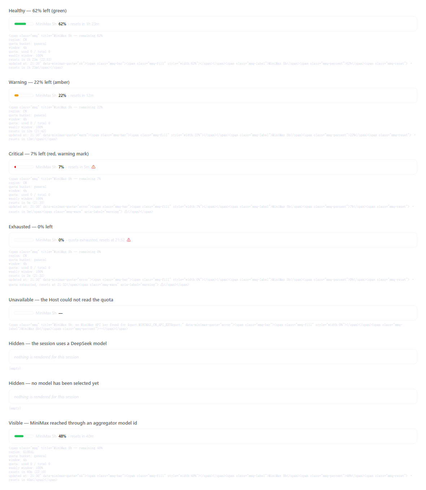
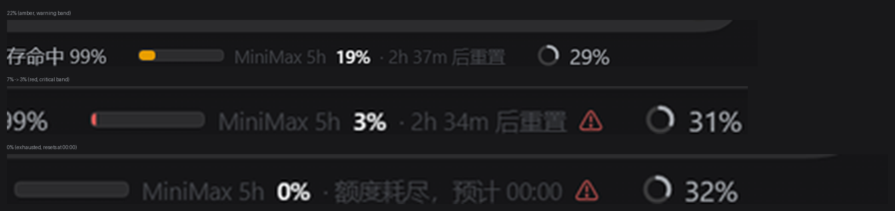

# MiniMax quota status line for DeepSeek Harness

Shows how much of the MiniMax token-plan window is left, directly under the
message composer, so a task never dies halfway through because the quota ran
out unnoticed.

```
▓▓▓▓▓▓░░░░  MiniMax 5h  62%  · 1h 23m 后重置
```

The reading updates on its own: the Host polls MiniMax, the browser reads the
Host's cached snapshot. No command to run, nothing to click.

## When it appears

The reading belongs to MiniMax sessions. The browser half reads the Session's
`modelSelection` projection — the same value the composer's model seat shows —
and renders nothing unless the selected provider or model id names MiniMax
(for example provider `minimax-cn`, or model `minimax/minimax-m2` through an
aggregator). Switching to DeepSeek or any other model removes the reading,
stops the 15-second route polling and suppresses low-quota notifications;
switching back brings it back. A blank Session with no selection yet shows
nothing.



Captured from the running Harness as the quota fell through the warning bands:



## What it shows

| Reading | When |
|---|---|
| `MiniMax 5h  62%  · 1h 23m 后重置` | more than 30% left — green bar |
| `MiniMax 5h  22%  · 12m 后重置` | 10–30% left — amber bar |
| `MiniMax 5h  7%  · 5m 后重置 ⚠` | 10% or less — red bar, warning mark |
| `MiniMax 5h  0%  · 额度耗尽，预计 21:32 ⚠` | the window is exhausted |
| `MiniMax 5h  —` | the Host could not read the quota (hover for the reason) |

Hovering the reading opens the details the API returned: region, quota bucket,
window length, used/total counts when the API reports them, the weekly window,
the reset time and when the snapshot was taken.

At 10% or less the plugin also raises one desktop notification per window. The
browser asks for notification permission the first time that happens; if the
permission is refused, the status line still carries the warning.

## Install

The plugin lives in this directory. Install it into the profile you use:

```bash
dsh plugin --profile desktop add "C:\path\to\dsh-minimax-quota"
```

Replace `desktop` with the profile you actually use (`dsh plugin --profile
<name> add <path>`). The same thing from inside a running Harness is the
**Plugin Manager → Install a bundle** action, or the `plugin_manager` tool's
`install_bundle`, with the absolute package directory as the target.

A local directory is linked, so edits to this folder are picked up after a
restart of the Harness. Restarting the Desktop app is the reliable way to
reload the browser half after a change.

## Configure

Everything is optional. The defaults suit a MiniMax China account whose key
lives in `MINIMAX_CN_API_KEY`.

| Field | Default | Meaning |
|---|---|---|
| `apiKeyEnv` | `MINIMAX_CN_API_KEY` | credential reference holding the API key |
| `region` | `CN` | `CN`, `GLOBAL`, or `AUTO` to probe both and keep the one that answers |
| `pollIntervalMs` | `60000` | how often the upstream endpoint is polled |
| `bucket` | `general` | the `model_remains[].model_name` bucket to display |
| `label` | `MiniMax 5h` | prefix of the reading |
| `warnPercent` | `30` | at or below this the bar turns amber |
| `criticalPercent` | `10` | at or below this the bar turns red and warns |

Edit your own profile layer, `$DSH_HOME/profiles/<profile>/cordis.patch.yml`,
and override the row the bundle inserted:

```yaml
- id: minimax-quota
  config:
    apiKeyEnv: MINIMAX_CN_API_KEY
    region: CN
    pollIntervalMs: 60000
    bucket: general
    label: MiniMax 5h
    warnPercent: 30
    criticalPercent: 10
```

A matching override replaces the complete `config`, so list every field you
want to keep.

### Where the API key comes from

The key never reaches the browser and is never written into the profile.

1. The configured `apiKeyEnv` reference is resolved through the Host
   credential store (`ctx.credentials.resolve`), which layers the process
   environment behind the stored value.
2. If that reference holds nothing, the plugin looks at the `llm-pi-ai`
   settings namespace and uses the `apiKeyEnv` of any configured MiniMax
   route — a profile that already set up `minimax-cn` needs no extra
   configuration at all.
3. If neither yields a key, the reading shows `—` and the hover detail names
   the missing reference.

The key is resolved per poll, so a rotated key applies on the next tick with
no restart.

## How it works

The plugin is a dual-half DSH plugin.

**Host half** (`index.js`) polls MiniMax and serves the snapshot:

| | |
|---|---|
| Upstream | `GET https://api.minimaxi.com/v1/token_plan/remains` (CN) or `https://www.minimax.io/v1/token_plan/remains` (GLOBAL) |
| Header | `Authorization: Bearer <API Key>` |
| Route | `GET /api/minimax-quota/remains`, loopback-only (peer address, `Host` header and `Origin` are all checked) |
| Lifecycle | the poll timer and the route are both registered with `ctx.effect`, so unloading the plugin stops the timer and removes the route |

**Browser half** (`client.js`) registers one entry in the
`conversation.composer.dock` slot, directly under the composer, next to the
host's own turn and token statistics:

```js
ctx.slots.inject('conversation.composer.dock', () =>
  ctx.slots.register(
    { name: 'conversation.composer.dock', id: 'minimax-quota', order: 20 },
    QuotaIndicator,
  ),
)
```

The entry reads `useProjection('modelSelection')` before rendering, so it only
polls the Host's route while the Session routes to MiniMax. It reads the route
every 15 seconds and re-renders the countdown every 20 seconds. Its styles are
rendered as a React element inside the component, so unmounting the entry
removes them, and it uses the host's theme tokens
(`--dsw-alias-state-success-primary` and friends) so it follows the host's
light and dark themes.

## About the upstream fields

The API's count fields are not always usable, so the plugin reads the
percentage field first and only falls back to the counts:

- `current_interval_total_count` and `current_interval_usage_count` are
  frequently reported as `0`. When that happens they say nothing about the
  quota.
- `current_interval_remaining_percent` is the authoritative signal and is
  used whenever it is present.
- `current_interval_usage_count` has been observed with two readings across
  MiniMax deployments: the amount consumed, and the amount left. A value
  larger than the total cannot be a consumption count, so it is read as the
  remainder; anything at or below the total is read as consumption. The
  reading that was applied is reported as `percentSource`
  (`percent`, `counts` or `counts-inverted`).
- `remains_time` is the remaining milliseconds of the interval and `end_time`
  is the absolute end of the window. They normally agree; when they do not,
  the interval remainder wins so the countdown never over-promises.

The window length is read from `end_time - start_time` rather than assumed to
be five hours — the API reports the window it actually counts.

## Compatibility

Verified against **DSH 0.2.2-rc.1** (the runtime shipped with Desktop 44.7.0)
on the `desktop` profile.

It uses `ctx.webServer.register`, `ctx.slots.inject` / `ctx.slots.register`,
`ctx.locale.register` / `ctx.locale.bind` and the
`conversation.composer.dock` slot. `conversation.composer.dock` is the slot
the host's own statistics use, so the reading sits in the same row.

The browser half needs a web composition (`dsh.client.platform: "web"`). It
runs in the Desktop app and in `dsh web`.

## What was checked

Both halves were exercised against the live MiniMax endpoint, and the reading
was observed in the running Harness as the quota fell from 62% to 0% during
the session — green, amber, red and then exhausted, with the ⚠ mark. The
window also enforced its own purpose: the session that built it was cut off
by the upstream `429 ... Token Plan 用量上限` while the status line was
showing the remaining quota.

The Plugin Manager lists the bundle as **MiniMax quota** with its own icon,
localized in every shipped language.

| Evidence | File |
|---|---|
| Every status, rendered with the host's own theme variables | [../docs/states.png](../docs/states.png) |
| Observed live: amber, red, exhausted | [../docs/live-states.png](../docs/live-states.png) |
| Observed live: healthy, light theme | [../docs/statusbar-zoom.png](../docs/statusbar-zoom.png) |
| The package icon renders | [../docs/icon-check.png](../docs/icon-check.png) |

## Tests

Two harnesses live outside the package, in the repository root:

- `tools/host-smoke.mjs` runs the real Host half against the live MiniMax
  endpoint with the key from the credential store, and asserts the snapshot
  and the loopback guard.
- `tools/client-render.mjs` loads `client.js` the way the browser's module
  table does, renders the component for every status, and asserts the tone,
  the bar width, the percentage, the countdown and the warning mark. It also
  asserts the model gate: a DeepSeek session and a Session without a selection
  render nothing, while a MiniMax model reached through an aggregator stays
  visible. `tools/extract-theme.py` extracts the host's own theme variables so
  the preview is faithful.

```bash
node tools/host-smoke.mjs      # hits the live endpoint; needs the stored key
node tools/client-render.mjs   # offline; rewrites docs/states.html
```
